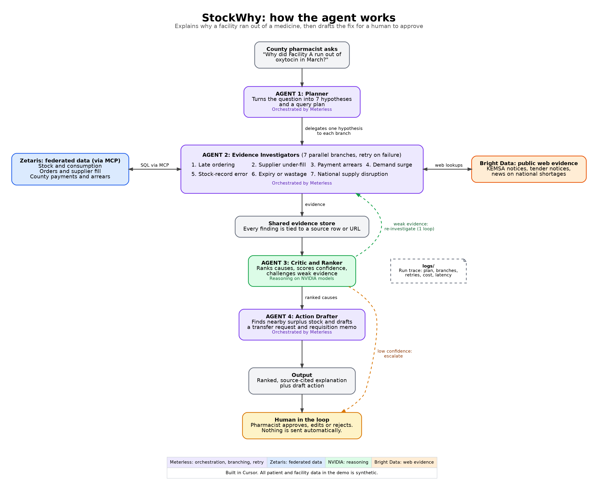

# StockWhy (working name)

An agent that explains **why a health facility ran out of an essential medicine** and drafts the fix for a pharmacist to approve.



> Open Agent Hackathon 2026. Track 2 (Explain Why), built to meet Track 1 (fragmented data).
> **All data in this repo is synthetic.** Contribution shares are evidence-weighted estimates, not statistics.

## Status (update this table as you build)

| Part | State |
|---|---|
| Synthetic data generator, seeded, plants a known cause | Working |
| 4 agents (Planner, Investigators x7 branches, Critic, Drafter), one revision loop, escalation, confidence | Working baseline, deterministic |
| Readable report, JSON result, agent trace in `logs/` | Working |
| Evaluation (`scripts/evaluate.py`): accuracy, precision, recall, F1, confidence calibration, citation validity, speed, at three noise levels | Working (self-made data, so a sanity check, not real-world accuracy) |
| Zetaris federation via MCP (`app/tools/zetaris_client.py`) | TODO |
| Meterless orchestration (`app/orchestration/meterless_flow.py`) | TODO (local thread pool stands in) |
| NVIDIA reasoning and extraction (`app/tools/nvidia_client.py`) | TODO |
| Bright Data web evidence (`app/tools/brightdata_client.py`) | TODO (reads cached notes offline) |
| Web UI (`app/ui/`) | TODO, optional |

## Run it (no keys, no manual steps)

```bash
python run.py --input input_examples/case1.json
# or with Docker
docker build -t stockwhy . && docker run stockwhy
```

Python 3.10+ and the standard library are enough for the baseline. `run.py` builds the dataset on first run (seeded), investigates, prints the report, and writes a trace and result to `logs/`.

**Try your own case**

```bash
python run.py --scenario-seed 42 --plant-cause demand_surge     # a brand-new unseen scenario
python run.py --dataset data/generated/default --facility FAC-005 --commodity "ORS sachet" --month 2026-03
python scripts/evaluate.py                                        # accuracy, precision, recall, F1 at 3 noise levels (about 1 minute)
```

Edit any CSV in `data/generated/<dataset>/` and re-run; the explanation changes with the data. In `input_examples/`, `plant_cause` is a **generator setting** that shapes the synthetic data. The agent never sees it.

## Agents

| Agent | Role | Input | Output | Collaborates with |
|---|---|---|---|---|
| 1. Planner | Checks a stock-out exists, lists hypotheses | Facility, commodity, month | Plan | Delegates to Agent 2 |
| 2. Investigators | One parallel branch per hypothesis, retry on failure | One hypothesis | Evidence, source rows | Reports to Agent 3 |
| 3. Critic and Ranker | Ranks causes, scores confidence, re-checks close calls once, escalates low confidence | All evidence | Ranked causes | Revision loop with Agent 2 |
| 4. Action Drafter | Finds nearby surplus stock, drafts a transfer and requisition | Ranked causes | Draft for human approval | Pharmacist |

## Examples

`input_examples/` holds 5 inputs; `output_examples/` holds the 5 matching outputs, produced by `scripts/make_examples.py` (never written by hand).

## How we measure it

`python scripts/evaluate.py` plants each cause under many seeds and noise levels, runs the agent, and compares with the planted truth. It reports top-1 and top-2 accuracy, precision, recall and F1 per cause, a confusion matrix, how accurate each confidence label really is, abstain rate, citation validity and speed. Results are saved to `logs/evaluation.md`. The data is synthetic and built by the same team as the detectors, so treat the numbers as a sanity check, not proof of real-world accuracy.

## Why nothing is hardcoded

Conclusions are computed from the data at run time. The planted cause is returned only to the scripts that back-test, and `app/` never reads `scripts/_truth/`.

## Limitations

- Synthetic data: accuracy on real facility data is unproven.
- The seven hypotheses may miss real causes; the agent then reports low confidence and escalates.
- The offline baseline uses rules; reasoning on NVIDIA models is not wired in yet.
- Nothing is sent automatically; every action is a draft for a human.

## Sponsor technologies (fill in as you integrate)

| Sponsor | Where it fits | Where in the code |
|---|---|---|
| Zetaris | Federated queries over stock, orders, payments via MCP | `app/tools/zetaris_client.py` |
| Meterless | Orchestration, branching, retry | `app/orchestration/meterless_flow.py` |
| NVIDIA | Critic reasoning, document extraction | `app/tools/nvidia_client.py` |
| Bright Data | Public web evidence | `app/tools/brightdata_client.py` |
| Cursor | Development environment | `.cursor/rules/` and the section below |

## How we used Cursor

_Fill in: what you built with it, example prompts, screenshots._

## Team and contributing

| Role | Owns |
|---|---|
| Data and Zetaris | `data/`, `app/synthetic.py`, `app/tools/zetaris_client.py` |
| Agent, Meterless and NVIDIA | `app/agents/`, `app/orchestration/`, `scripts/run_backtest.py` |
| Domain, UI and story | `app/ui/`, `input_examples/`, `README.md`, demo video |

Short branches, small pull requests into `main`, keep `main` runnable, run `python scripts/evaluate.py` before merging, never commit `.env`.
